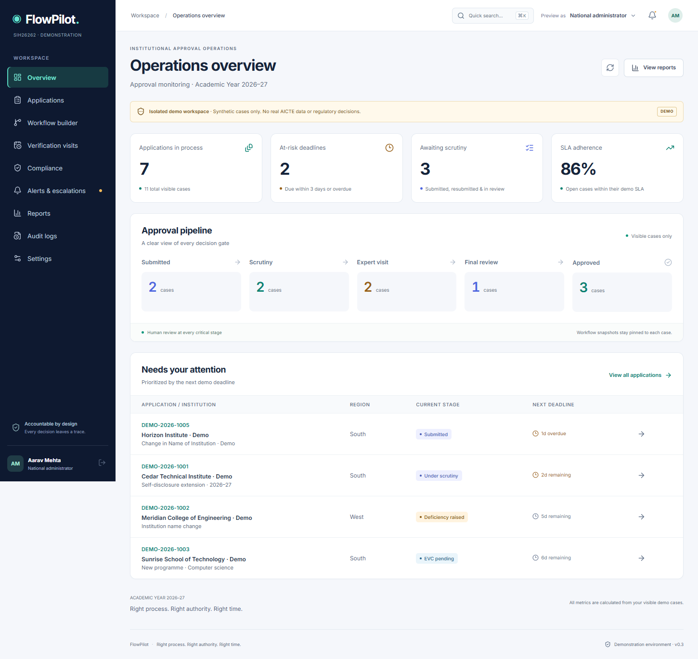

# Clauseway

**A traceable approval-workflow and continuing-compliance prototype for Smart India Hackathon 2026.**

**Team Verity · SIH26262 · Smart Automation · Software**

[](https://github.com/Stakeylock/sih26-1/actions/workflows/ci.yml)
[Implementation](docs/implementation notes) · [Validation](docs/VALIDATION.md) · [Demo walkthrough](docs/demo walkthrough) · [Deployment readiness](docs/DEPLOYMENT_READINESS.md)

> **Demonstration only.** Clauseway uses synthetic identities, documents, applications, approvals and timelines. It is **not an official AICTE service**, has no live AICTE integration, and must not be used to issue or verify real regulatory approvals.



## Why Clauseway?

Approval cases span evidence, scrutiny, inspection, decisions and obligations that can remain open after a decision. Clauseway keeps the case, its governing workflow version, reviewed evidence and recorded actions together. When an evidence link or declared review input changes, it flags the **affected configured findings** for re-review without silently treating unrelated reviews as stale. Authorized people—not the software—make decisions.

This is **evidence-linked revalidation**, not a claim to invent selective re-scrutiny or provide general semantic dependency inference.

## What the prototype demonstrates

- **Dossier and claim ledger:** evidence links, deficiencies, responses, validity review and targeted claim rechecks.
- **Role-scoped workflow:** authenticated local workspace with user, institution and region checks enforced by PostgreSQL and row-level security.
- **Policy versioning:** recorded routes, calendars, authority gates, policy notices, explicit adoption and case-specific snapshots.
- **Inspection coordination:** expert availability, conflict checks and reservation constraints.
- **Continuing compliance:** post-decision obligations, document expiry and pending actions.
- **Trust and history:** SHA-256-linked audit events, recorded review bases, replayable snapshots and scoped exports.
- **Reliability:** durable notification/deadline/scan jobs; private upload quarantine and a **locally tested** ClamAV scanner.
- **Optional analysis:** explainable, source-pinned what-if analysis and an optional 3D evidence relationship view.

The optional LangGraph advisory is deterministic and does **not** call an external LLM or decide cases. The separately packaged n8n runtime is **disabled** pending dependency remediation.

## Quick start

Requires **Node.js 22** and npm. Start the standalone synthetic demo without Docker:

```bash
npm ci
npm run dev
```

Open the loopback URL printed by Vite (normally `http://127.0.0.1:5173`). This is the **isolated browser demo**, with preview personas, synthetic documents and no real backend permissions. Some advisory/pre-check functionality requires its separate local service.

For the **full local authenticated stack**, additionally install Docker Desktop and use the project's Supabase CLI dependency:

```bash
npm run local:setup   # first-time local provisioning
npm run local:start   # local Supabase + workers + advisory + both frontends
```

The launcher uses loopback-only services: isolated demo `5174`, authenticated frontend `5173`, Supabase API `55321`, advisory `8787`, and worker health `8791`. The connected frontend signs in with explicitly provisioned **synthetic accounts**; credentials remain in ignored local environment files. See [local setup and troubleshooting](docs/LOCAL_RUN.md).

## Architecture

```text
React 19 / TypeScript / Vite
  ├─ Isolated demo adapter → in-memory synthetic cases and demo audit replay
  └─ Connected adapter → Supabase Auth + PostgreSQL RPCs + RLS
                              ├─ Versioned cases, claims, decisions, audit events
                              ├─ Private Storage (quarantine before release)
                              └─ Durable jobs → ClamAV / deadlines / in-app delivery

Separate local advisory service → deterministic, read-only LangGraph summary
Optional n8n workflow runtime → disabled due to unresolved dependency findings
```

| Area | Source |
| --- | --- |
| Application shell and screens | `src/App.tsx`, `src/ui/` |
| Domain rules and audit representation | `src/domain/` |
| Demo and connected data adapters | `src/data/demo.ts`, `src/data/supabase.ts` |
| Database schema, permissions and RPCs | `supabase/migrations/` |
| Local worker and scanner | `workers/`, `deploy/` |
| Advisory automation | `automation/` |
| Automated validation | `tests/`, `e2e/`, `scripts/` |

## Verify the build

```bash
npm run build
npm test
npm run test:e2e
```

With the full local services available, run `npm run test:connected`, `npm run test:reliability:local`, and `npm run test:scale:local` as appropriate. These tests may require their own isolated local environment and should **not** be pointed at production records. The `scripts/release-check.mjs` release gate intentionally returns a non-zero exit code while its blockers remain.

The recorded 25 October synthetic PostgreSQL run used **10,000 cases**, **100 virtual clients** sharing **25 database connections**, and measured **522.64 operations/s** with **273.07 ms p95 register reads** over about **11.1 seconds**. Those are database-test measurements, **not end-to-end production capacity or regulatory SLAs**. See [test methodology and limitations](docs/scalability-audit.md) and [raw results](docs/scale-results.json).

**Latest recorded CI status and limitations:** [Validation](docs/VALIDATION.md). Automated checks and local scanner integration are not a penetration test, official authorization or production certification.

## Documentation

Start at the [documentation index](docs/README.md). For an evaluation, follow the [six-minute case walkthrough](docs/demo walkthrough). For staging and Vercel, read [deployment readiness](docs/DEPLOYMENT_READINESS.md) first: **the Vercel build produces the synthetic frontend; it does not deploy the connected database, advisory or scanning worker.**

For contributions, see [CONTRIBUTING.md](CONTRIBUTING.md). To report a security concern, see [SECURITY.md](SECURITY.md). The code is released under the [MIT License](LICENSE).
