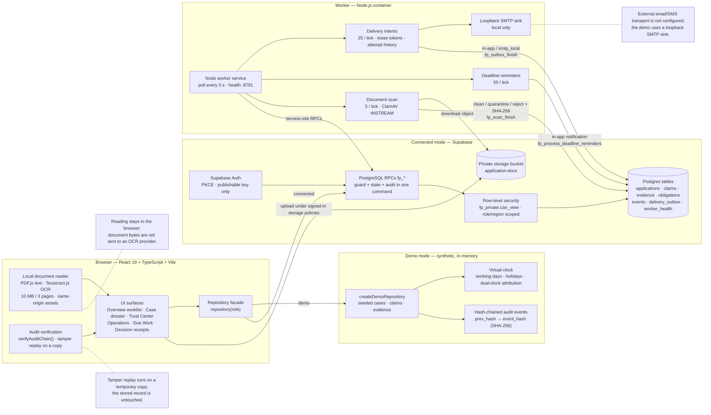

# Architecture diagram source — Clauseway (SIH 2026 PS 26262)

Self-contained source for generating an SVG of the architecture and tech stack.
It describes the shipped evidence-review prototype; it is not a claim of production
deployment, live AICTE integration, or a supported production user count.

## Tech stack

| Layer | Technology | Role in this prototype |
|---|---|---|
| UI | React 19.3, TypeScript 7.0, Vite 8.3 | Hash-routed workspace, role picker, all screens |
| UI support | lucide-react, @fontsource/inter, Zod 4.6 | Icons, type, input/schema validation |
| Evidence scene | Three.js 0.186 | Read-only 3D evidence-relationship view (`EvidenceScene`) |
| Local reading | pdfjs-dist 6.4 | Extract embedded PDF text in the browser |
| Local OCR | tesseract.js 7.0 + `@tesseract.js-data/eng` | English OCR for image-only pages and PNG/JPEG; same-origin assets under `/ocr` |
| Demo mode | In-memory repository (`createDemoRepository`) | Synthetic cases, claims, evidence, virtual clock, hash-chained events |
| Connected mode | Supabase JS 2.118, Postgres, Auth, Storage | PKCE auth, `fp_*` RPCs, RLS, private `application-docs` bucket |
| SQL tests | PGlite 0.5 | Real migrations exercised without a hosted database |
| Worker | Node.js service, Docker Compose | Outbox delivery, deadline reminders, document scans, health endpoint |
| Malware scan | ClamAV container | INSTREAM scan, signature-age check, clean/quarantine/reject |
| Integrity | SHA-256 hash chain | `prev_hash` + `event_hash`, `verifyAuditChain()`, tamper replay on a copy |
| Tests | Vitest 5, Playwright 1.64, axe-core 4.14 | Unit, SQL-gated, browser, accessibility |

## Architecture

## Data flows

1. **Command path.** UI → repository facade → `fp_*` RPC → RLS/guards → audit event + state change in one transaction. Version, role, region, document validity and open deficiencies are checked before mutation.
2. **Upload and scan.** Browser uploads to the private `application-docs` bucket under the signed-in user's storage policies → finalization RPC registers a durable scan job → worker downloads the immutable object, checks size and declared MIME, scans through ClamAV INSTREAM, records SHA-256 + engine version → only a definitive clean verdict releases the document; operational failures stay quarantined and retry with backoff.
3. **Delivery.** A workflow command writes the in-app notification and its outbox intent in the same transaction → worker claims an intent with an expiring lease token → in-app or loopback SMTP sink → immutable attempt history. Uncertain SMTP acceptance remains `ambiguous` for human reconciliation.
4. **Local reading.** Local PDF/PNG/JPEG → PDF.js text extraction, Tesseract English OCR where needed → candidate fields with page, excerpt, method and source SHA-256 → human review → existing authorized validity write. No new permission or endpoint; the reader cannot accept a claim or record a review by itself.
5. **Verification.** Trust Center → `verifyAuditChain()` recomputes every `prev_hash`/`event_hash` link and fails closed on alteration → tamper simulation runs on a temporary copy and names the mismatch. Boundary: this covers stored event history only, not the truth of the underlying claims.

## Boundary contract

| Boundary | What crosses | Enforced by |
|---|---|---|
| Browser → Demo | Demo reads/writes through `createDemoRepository` | TypeScript + in-memory store |
| Browser → Connected | `fp_*` RPC calls and storage policies | `fp_private.can_view` / RLS / RPC guards |
| Browser → Local reader | Document bytes stay in the tab | PDF.js / Tesseract same-origin assets |
| Worker → Connected | Service-role RPCs only | `WORKER_TARGET` + host allowlist + server-only key |
| Demo ↔ Connected | None — modes are mutually exclusive per workspace | `repo.mode` gate |

## What is intentionally NOT in this diagram

- No dispatch, control-tower, or cockpit composition (prohibited by engineering conventions).
- No simulated reviewer identities, official seals, or fabricated decision outcomes.
- No production SLA, live AICTE connection, or external email/SMS provider.
- No visual fraud detection, stamp matching, or approval-probability model.
- No backend behavior added to support layout — the layout reads existing surfaces only.

## SVG brief (for the diagram generator)

- **Layout:** three columns, left to right: **Browser** → **Mode switch** (Demo / Connected) → **Backend**. Put the **Worker** beneath the Connected column, with arrows up into the RPC/database layer.
- **Palette:** navy `#14213d` for headings, slate `#475569` for body text, white cards, light-blue `#e8f1f8` for backend, light-amber `#fff4d6` for honest-boundary notes, red `#b42318` only for the tamper-detection path.
- **Node style:** rounded rectangles for components, cylinders for Postgres and storage, dashed borders for demo-only and local-only paths, solid arrows for runtime calls, dotted arrows for notes.
- **Must show as chips:** React 19 · TypeScript · Vite · Supabase (Postgres + RLS + Auth + Storage) · PGlite · PDF.js · Tesseract.js · ClamAV · Node worker · SHA-256 hash chain · Docker Compose.
- **Must show as a footer strip:** "Synthetic prototype. No production deployment, live AICTE integration, or external messaging claimed."
- **Keep labels short**; put detail in the data-flow legend rather than inside the nodes.

## Rendering

Render the Mermaid block with any Mermaid renderer (VS Code preview, mermaid-cli, or the repo docs build), or hand the whole file to an SVG generator using the brief above. Keep this file in sync when component boundaries or pane composition change.
